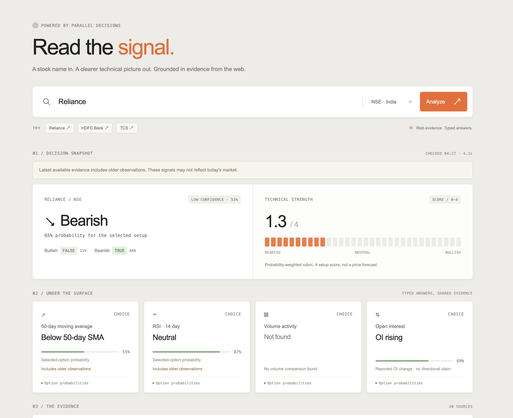
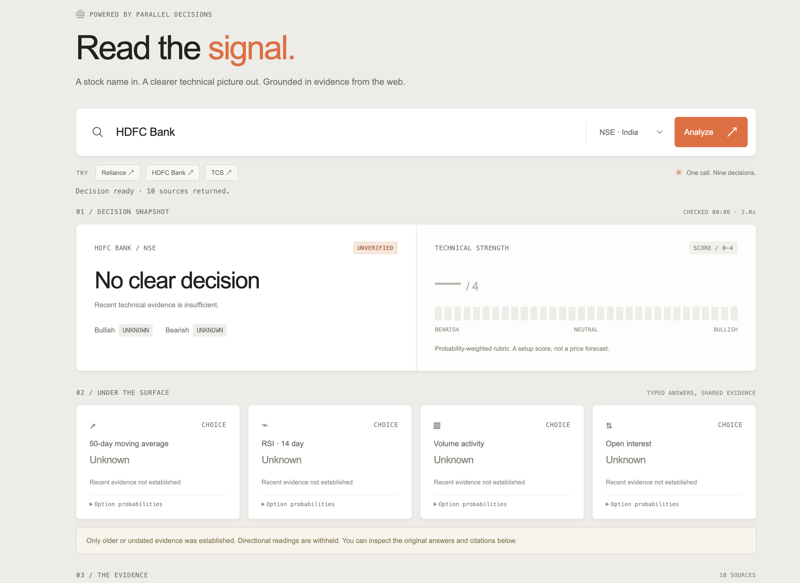
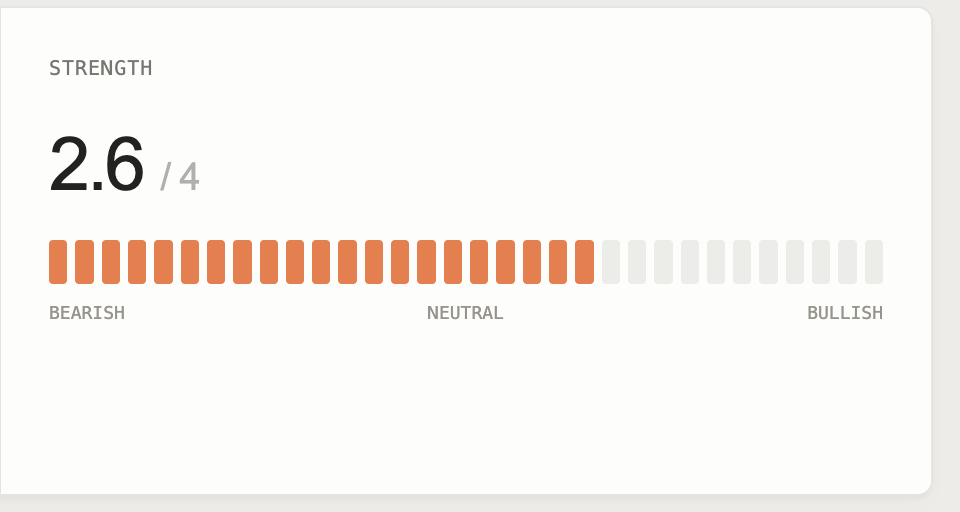
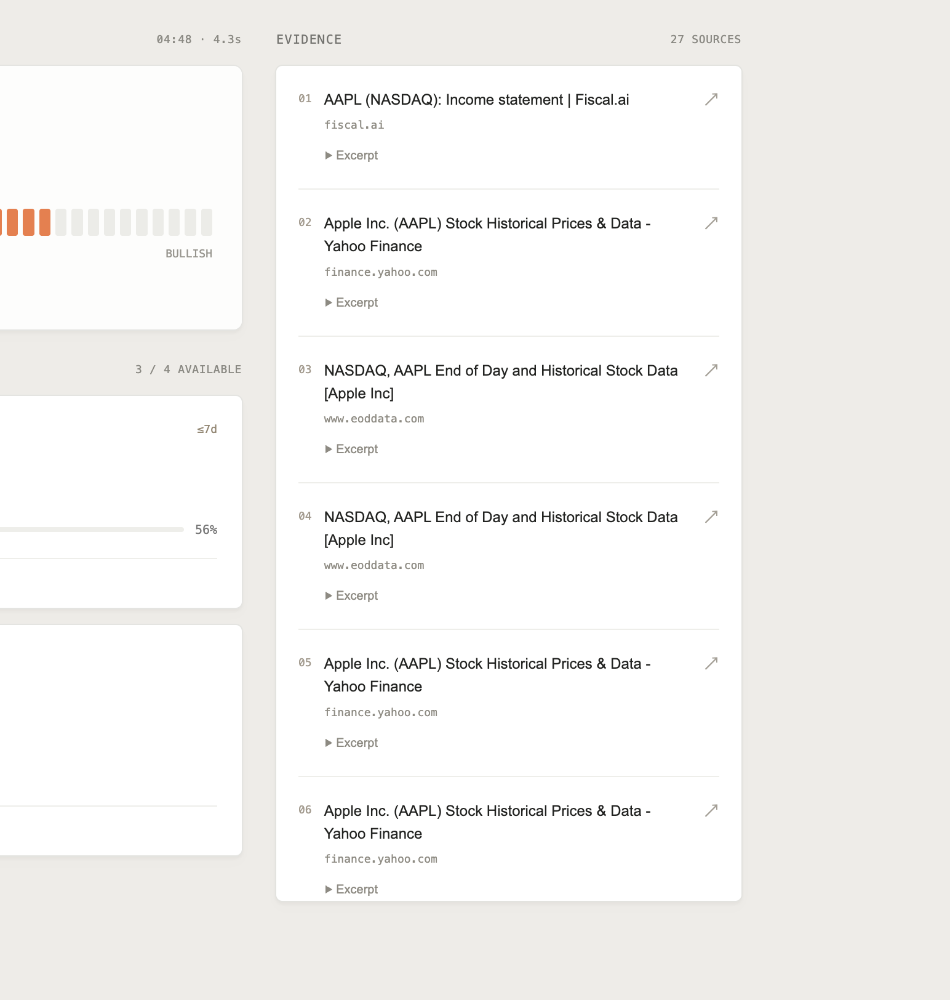

# parallel-ticker

Stock signals with probabilities and sources. A minimal demo of the free [Parallel Decisions API](https://docs.parallel.ai/decisions/decisions-quickstart) for US and Indian stocks.

[Live demo](https://parallel-ticker.vercel.app) · [Parallel.ai](https://parallel.ai/) · [API integration](lib/decisions.mjs)

## Run locally

Requires Node.js 22+; no dependencies or API key.

```sh
git clone https://github.com/hckmstrrahul/parallel-ticker.git
cd parallel-ticker
npm run dev
```

Open [localhost:4317](http://localhost:4317). Run `npm test` to check the integration, streaming, and request validation.

## How it was built

Vanilla HTML, CSS, and JavaScript with a Node.js backend. Built with Codex from [Parallel's UI](https://parallel.ai/) references, then refined through screenshot feedback. Vercel serves the frontend and runs the same backend through [a function adapter](api/decisions.mjs).

1. A stock name and exchange become focused questions in [lib/decisions.mjs](lib/decisions.mjs).
2. Two concurrent `web_decisions` calls assess technicals and trading activity using the [free Parallel MCP endpoint](https://docs.parallel.ai/integrations/mcp/quickstart#web_decisions).
3. Typed answers drive bullish/bearish probabilities, a 0–4 strength score, SMA, RSI, volume, and open interest. Citations populate the evidence sidebar.
4. Initial results stream immediately after those calls. Missing signals get one focused retry with a 90-day evidence window, expanded from 30 days.

Only Decisions supplies analysis. No separate model or market-data API. Results may be unavailable or dated; evidence age remains visible. Probabilities describe the selected reading, not future returns. Citations are shared per request.

The [server](server.mjs) exposes `POST /api/decisions` with `{ "stock": "AAPL", "market": "US" }`. It returns JSON, or streamed NDJSON when requested. Results are cached for five minutes per running instance. Free-service rate limits apply.

## Screenshots

Development snapshots captured during iteration; some precede the final layout and naming.

| Analysis | Insufficient evidence |
| --- | --- |
|  |  |

| Strength module | Evidence sidebar |
| --- | --- |
|  |  |
