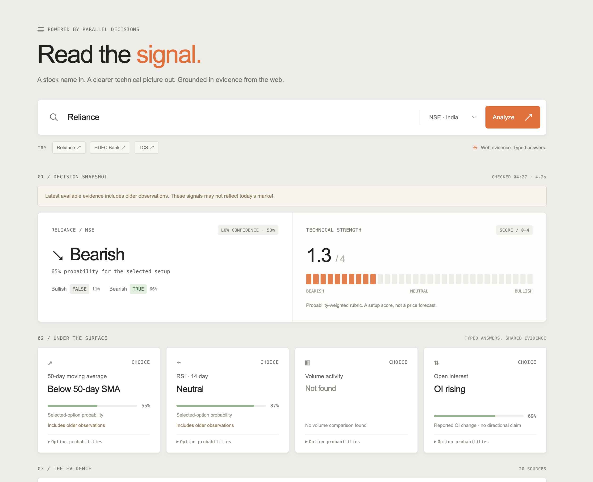

# parallel-ticker

Explore stock signals for US and NSE-listed companies, with probabilities, dated evidence and source links. A small web app built around the [Parallel Decisions API](https://docs.parallel.ai/decisions/decisions-quickstart).

[Live demo](https://parallel-ticker.vercel.app) · [API integration](lib/decisions.mjs)



*Development capture; some labels and layout details differ from the current interface.*

## Run locally

Requires **Node.js 22+** and internet access for analysis. There are no packages to install or API keys to configure in this implementation.

```sh
git clone https://github.com/hckmstrrahul/parallel-ticker.git
cd parallel-ticker
npm run dev
```

Open [localhost:4317](http://localhost:4317), choose **US** or **NSE India**, and enter a stock name or ticker. The evidence sidebar shows sources and observation age. Use `PORT=4318 npm run dev` if the default port is occupied.

## Read the results

The app summarizes trend, RSI, moving average, volume and open interest. Two concurrent Decisions calls assess technicals and trading activity; initial results stream before focused retries for missing readings.

Readings can be unavailable, undated or older than the latest trading session. Probabilities describe the selected interpretation of available evidence, not the chance of a future return. The app does not provide a live market-data feed. Provider availability and rate limits still apply.

## API

The local server and Vercel adapter share `POST /api/decisions`:

```sh
curl http://localhost:4317/api/decisions \
  -H 'Content-Type: application/json' \
  -d '{"stock":"AAPL","market":"US"}'
```

`market` accepts `US` or `NSE`. Add `Accept: application/x-ndjson` for streamed snapshots and a final result; cached responses return JSON. Successful results are cached for five minutes per server instance.

## Development

```sh
npm test
```

Tests cover request validation, Decisions integration, streaming and deployment configuration using controlled responses. The frontend is vanilla HTML, CSS and JavaScript; the backend uses Node.js built-ins.

| Source | Responsibility |
| --- | --- |
| [public/](public/) | Interface, stock suggestions and result rendering. |
| [lib/decisions.mjs](lib/decisions.mjs) | Questions, MCP transport, evidence and recovery. |
| [server.mjs](server.mjs) | Local HTTP server, validation, streaming and cache. |
| [api/decisions.mjs](api/decisions.mjs) | Vercel function adapter. |

Built with Codex, with interface references from [Parallel.ai](https://parallel.ai/).
